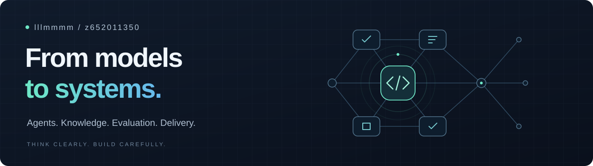

<picture>
  
</picture>

探索 **AI 原生时代的系统设计与人机协作**。关注智能如何持续行动、学习如何重新发生、知识如何不断生长，以及复杂系统如何可靠演进。

### Areas of exploration

**Agentic Systems** · 探索智能体的自主性、协作机制与可组合架构，让智能从单次响应走向持续行动，从个体能力走向系统能力。

**AI-Native Learning** · 探索以 AI 为原生环境的学习逻辑，重新理解人与知识、实践和反馈的关系，让学习成为持续创造与演进的过程。

**Knowledge & Memory** · 关注长期记忆、上下文组织与知识演化，探索如何将分散的经验沉淀为可积累、可迁移、可持续生长的智能。

**Trustworthy AI** · 研究智能系统的能力边界、可验证性与信任机制，思考如何让自主性、可靠性与人的控制权共同演进。

---

Thinking in systems. Building for what comes next.
