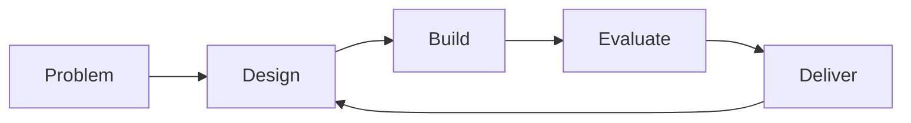

<picture>
  
</picture>

我关注 **AI 如何成为真正可用的系统**：从智能体工作台、教育与安全场景，到数据平台、评测验证和工程交付，把想法做成能够持续迭代的产品。

### What I work on

**Agent Systems** · 通用智能工作台、插件与工具编排、会话上下文和知识记忆，探索让 Agent 在真实任务中持续工作的方法。

**Learning & Knowledge** · 智慧教学、实网实践、课程能力图谱与个人知识库，设计从学习、创作到验证反馈的连续体验。

**Security & Evaluation** · 授权环境中的安全 Agent 研究、可复现评测与消融实验，以及规则驱动的 API 规范审计。

**Platforms & Delivery** · 医疗科研数据平台与可视化、全栈原型、架构解耦、性能优化和可观测性，关注系统从演示走向实际使用的每一步。

### Selected public work

| Project | What it explores |
| :--- | :--- |
| [**API DFX · api-scan-easy_rules**](https://github.com/z652011350/api-scan-easy_rules) | 面向 HarmonyOS / OpenHarmony 的 API 规范审计：以 Agent、规则和结构化证据连接声明提取、实现分析与结果验证。 |
| [**LSniffer**](https://github.com/z652011350/LSniffer) | 基于 Python、Scapy 与 Tkinter 的网络协议分析课程实验，支持实时抓包、协议过滤和 TCP 流量追踪。 |

### How I build

把目标写成清晰的契约，用实验校准判断，让测试、可观测性与交付证据进入日常开发。既关注产品体验，也愿意深入系统边界和性能瓶颈。

**Toolbox** · TypeScript / Python · React / Vue · Node.js / FastAPI · PostgreSQL / Redis · Docker / CI/CD · MCP / Agent tooling

Building systems that can be understood, tested, and improved.
